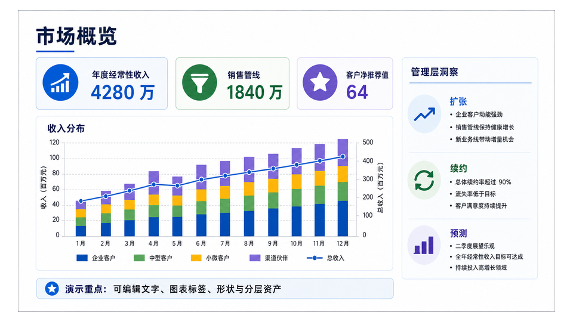
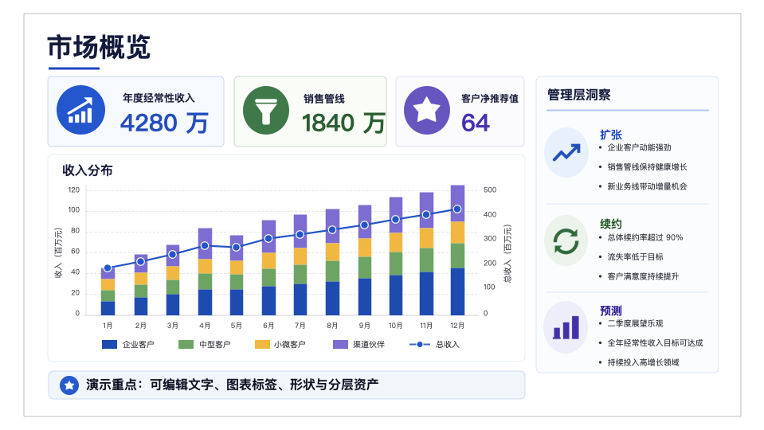
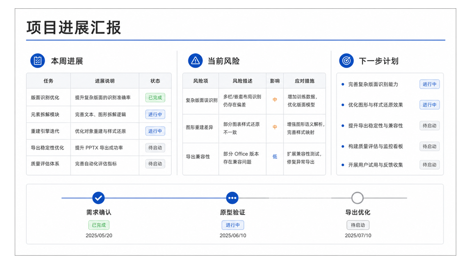
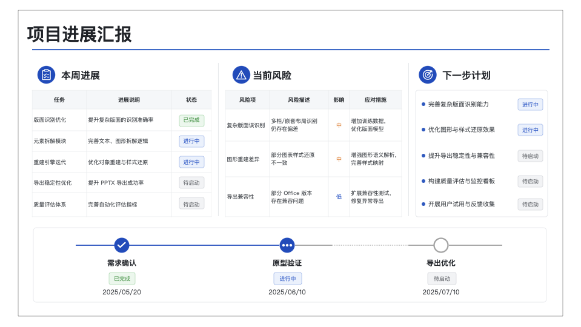

# Image to Editable PPT — Claude Code Skill

[](LICENSE)
[](https://docs.claude.com/en/docs/claude-code)
[](#development)
[](skills/image-to-editable-ppt/cli/pyproject.toml)

A [Claude Code](https://docs.claude.com/en/docs/claude-code) skill that turns **slide screenshots, image-only PDFs, and flattened PPTX decks back into editable PowerPoint**. Text becomes native text boxes, tables become native PowerPoint tables, and lines and cards become native shapes. Icons and illustrations are **re-traced as SVG vectors** that PowerPoint can convert into editable shapes.

It runs entirely inside Claude Code: **no image-generation API, no OCR token, and nothing uploaded by default.**

| Source image | Rebuilt as editable PPTX |
|---|---|
|  |  |
|  |  |

<sub>Right column: the generated `.pptx` rendered by Keynote. Every text run, table cell, chart bar, and icon is a separate, editable object. More examples are under [Examples](#examples).</sub>

## Why this exists

Many slides only survive as pictures: a screenshot in a chat, a scanned handout, a PDF export, or a deck from a tool that flattened every slide into one image. Retyping them is slow, and "OCR + paste" loses the layout. This skill rebuilds each page as **PowerPoint objects at their original positions**, so you can edit a date, restyle a table, or move an icon as if you had the original file.

## Features

- **Inputs:** one or more images (PNG/JPG), multi-page PDFs, and image-based `.ppt`/`.pptx`. Page order is preserved, and **speaker notes are copied verbatim**.
- **Native text:** font sizes and positions are measured from the source pixels, each paragraph is one text box with real line spacing, and same-level text keeps one size.
- **Native tables:** row-and-column tables become real PowerPoint tables with merges and styling.
- **Vector icons:** Claude traces each icon, logo, badge, or flat illustration as SVG, with a zoom-grid and colour-sampling loop and a fidelity score against the source. The deck embeds the SVG itself, so **Convert to Shape** in PowerPoint makes it fully editable.
- **Photos stay photos:** photographic regions are kept as images, and backgrounds behind rebuilt text are cleaned by local inpainting.
- **Parallel pages:** multi-page inputs fan out to background Claude Code agents, one per page, coordinated by a deterministic state machine.
- **Validation:** every page and the final deck are checked deterministically. The checks cover package integrity, asset provenance and hashes, and native-text coverage. They also reject a common shortcut that only *looks* editable: a full-slide screenshot with text boxes on top.
- **Local OCR:** [RapidOCR](https://github.com/RapidAI/RapidOCR) reads Chinese and Latin text on-device. PaddleOCR-VL (cloud) and [Indra OCR](https://github.com/datalab-to/indra) are optional backends.

## Quick start

**Requirements:** Claude Code, Python 3.10+, and [`uv`](https://docs.astral.sh/uv/) (or `pipx`/`pip`).

```bash
git clone git@github.com:bowen31337/claude-image-to-editable-ppt.git
cd claude-image-to-editable-ppt

# 1. Install the skill for all projects (a symlink keeps it updatable with git pull)
mkdir -p ~/.claude/skills
ln -sfn "$PWD/skills/image-to-editable-ppt" ~/.claude/skills/image-to-editable-ppt

# 2. Install the bundled editppt runtime (the skill also does this on first use)
uv tool install --force --editable skills/image-to-editable-ppt/cli
editppt doctor
```

Then ask Claude Code in plain language. The skill triggers automatically:

```text
Turn ~/Desktop/roadmap.png into an editable PowerPoint so I can change the dates.
Convert vendor_pitch.pdf into an editable pptx and save it to outputs/.
This deck is all flattened pictures. Make it editable again and keep my speaker notes.
```

The deck is written to the folder you name. Otherwise it goes to `output/image-to-editable-ppt/<job>/final/`.

## How it works

```text
input ─▶ editppt prepare ─▶ per-page jobs ─▶ page reconstructors ─▶ editppt run record ─▶ editppt run finalize ─▶ .pptx
         (normalize, OCR      (state machine)   (1 page: main session;   (validate each page)   (rebuild from manifests,
          text hints)                            N pages: parallel agents)                       copy notes, validate deck)
```

For each page, the reconstructor decides every object's source in a fixed order: **background → foreground assets → native elements**. Each object then gets one of three sources:

| Object | Source | Command |
|---|---|---|
| Icons, logos, badges, hand-drawn marks, flat illustrations | SVG trace by Claude | `editppt image zoom` → `editppt image svg` |
| Photos, screenshots, textured image blocks | Rectangular source region | `editppt image photo-region` |
| Complex backgrounds behind rebuilt text | Local OpenCV inpainting | `editppt image inpaint` |

The page is described in a `manifest.json`, which is the single source of truth. That manifest is built into `page.pptx`, validated, and later reassembled into the final deck.

## Text-hints OCR backends

| Backend | Default | Notes |
|---|---|---|
| `rapidocr` | ✅ (no token) | Local PP-OCR models on ONNX Runtime. Read 39/39 key strings on the eval slides, 0.5–1.2 s/page. |
| `paddleocr-vl` | ✅ when a token is set | Cloud PaddleOCR-VL; adds layout analysis. `editppt config --paddle-ocr-token <token>` |
| `indra` | opt-in | [Indra OCR](https://github.com/datalab-to/indra): about 4× faster and adds paragraph layout blocks; 38/39 on the eval slides. Its model weights use a modified OpenRAIL-M license. Install the `[indra]` extra, then `editppt config --text-hints-backend indra` |
| `builtin-ink` | fallback | Geometry only (where text is and how large); used when nothing else is available |

## Examples

| Source | Editable PPTX (Keynote render) |
|---|---|
|  |  |
|  |  |

The status report has native tables, traced icons, and a native timeline. The investment slide has 22 traced icons, 6 photo regions, and about 60 editable text boxes.

## Evaluation

Three evals (single slide, two-image deck, image-only PDF) were run with the skill and as a no-skill baseline (Claude Opus with general tools), and scored by a deterministic grader:

| | With skill | Baseline |
|---|---|---|
| Assertions passed | **19 / 19** | 15 / 19 |
| Typical cost per complex page | $2–6 | $0.6–0.8 |
| Typical time per complex page | 5–15 min | 3–4 min |

The grader includes a skill-specific check (icons embedded as SVG), so the headline gap overstates the difference. The clearer differences are qualitative. The skill preserves the source geometry and produces editable vector icons. The baseline approximated icons with basic shapes or pasted raster crops of the source. A flattened-PPTX eval also confirmed that speaker notes carry over byte-for-byte.

## Cost and limitations

- **It is thorough, not cheap.** Expect roughly 5–15 minutes and $2–6 of model usage per complex page. Multi-page decks run pages in parallel.
- **It reconstructs; it doesn't copy pixels.** Traced icons are faithful but not byte-identical, and fonts are matched rather than embedded.
- **Photos with irregular outlines** keep their rectangular background unless an image-generation API is configured (an optional upgrade path).
- **Verified in Keynote** and with strict OOXML parsing (`python-pptx`, `lxml`). The SVG embedding follows PowerPoint's own `svgBlip` structure, but this port has not yet been opened in Microsoft PowerPoint.
- **Not a deck generator.** For new presentations from an outline or article, use a deck-authoring tool instead.

## Repository layout

```text
skills/image-to-editable-ppt/      the installable skill
├── SKILL.md                       orchestrator instructions (read by Claude)
├── prompts/page-worker.md         per-page reconstructor prompt template
├── references/                    decision tree, manifest schema, CLI reference
├── scripts/                       worker-prompt builder
├── cli/                           the editppt runtime (Python package)
└── evals/evals.json               eval prompts and assertions
tests/                             upstream test suite + Claude-native tests
docs/showcase/                     README images
```

## Development

```bash
uv run --no-project --with pytest --with pillow --with numpy --with pymupdf --with pyyaml \
  --with requests --with openai --with resvg-py --with opencv-python-headless \
  --with rapidocr --with onnxruntime python -m pytest -q tests
```

Add `--with indra-ocr` to run the optional Indra tests as well. Tests for optional backends skip cleanly when those packages aren't installed.

## Credits

This is a Claude Code port of **[ningzimu/image-to-editable-ppt-skill](https://github.com/ningzimu/image-to-editable-ppt-skill)** (MIT), originally built for Codex, at upstream commit `b7be494`. The upstream `editppt` runtime, its state machine, and its decision rules form the foundation. This port adds:

- Claude Code orchestration
- the `claude-native` asset backend (SVG tracing, inpainting, photo regions) with its validator guards
- SVG embedding in the deck
- paragraph line spacing
- local RapidOCR and opt-in Indra text hints
- `editppt page merge-fragments`

The source images in `docs/showcase/` come from the upstream repository.

## License

[MIT](LICENSE). It retains the upstream copyright notice. Optional third-party backends carry their own licenses; in particular, Indra OCR's model weights are licensed separately.
